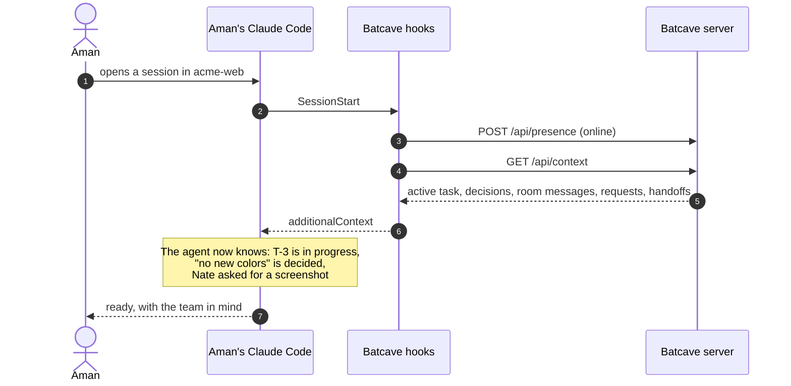
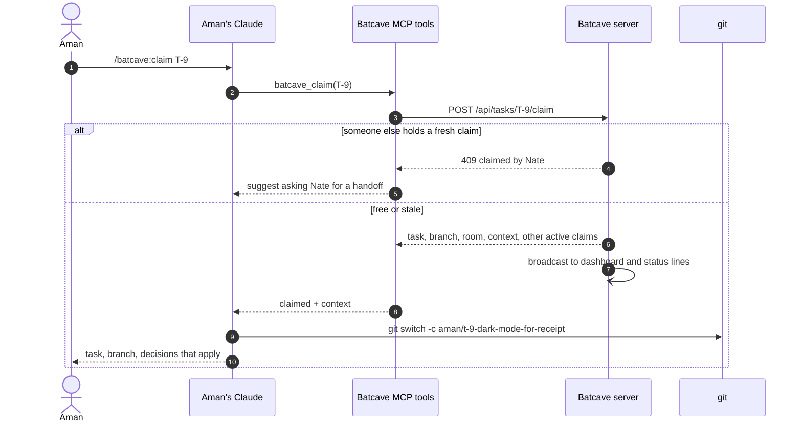
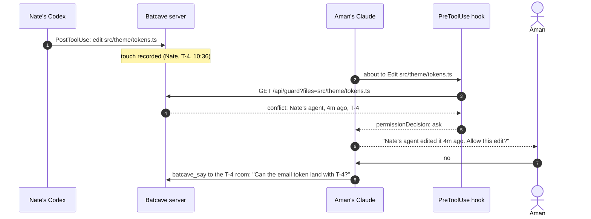
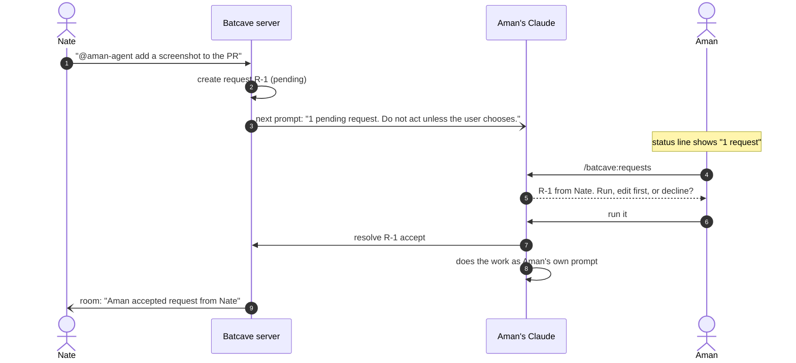
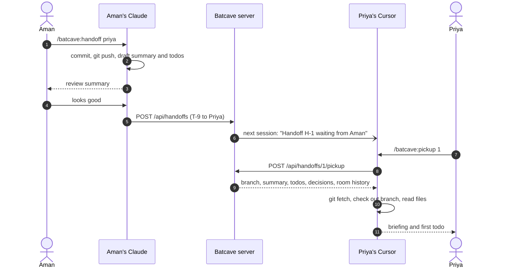

<p align="center">
  
</p>

<p align="center">
  <a href="LICENSE"></a>
  
  
  
  
</p>

<p align="center">
  <b>A shared board, live presence, rooms, pinned decisions, requests between teammates' agents, handoffs and an edit guard.</b><br>
  For teams where everyone runs their own coding agent: Claude Code, Codex, Gemini CLI, Antigravity, Cursor, Copilot CLI, OpenCode, Kiro or Windsurf.
</p>

<p align="center">
  <a href="#quick-start">Quick start</a> ·
  <a href="#a-day-in-batcave">A day in Batcave</a> ·
  <a href="#works-with">Works with</a> ·
  <a href="#features">Features</a> ·
  <a href="#how-it-works">How it works</a> ·
  <a href="#api-reference">API</a> ·
  <a href="#roadmap">Roadmap</a>
</p>

---

## See it

**In your terminal.** Claim a task, get stopped before you overwrite a teammate's work, and run a request a teammate sent to your agent.

<p align="center"></p>

**On the dashboard.** The same state, live, for everyone who does not live in a terminal. Cards move on their own as agents start work and open PRs.

<p align="center"></p>

**In your status line.** The team, always one glance away.

<p align="center"></p>

---

## Why

Coding agents made each developer faster and the team slower to align. More agents mean more code, more PRs and more merge conflicts, while the team's shared context sits in private terminals.

So teams are back to asking the basic questions all day:

> *Who is working on what? What did we decide? Whose agent is touching this file? Where did my teammate leave off?*

Batcave answers them inside the tool everyone already uses, without changing how anyone works.

### The one rule: everyone runs their own agent

Batcave never holds anyone's credentials, never proxies model calls, and never runs one person's agent on another person's behalf.

Aman can be on Claude Code, Nate on Codex and Priya on Cursor. They share one board, one set of decisions and one guard.

When Nate wants Aman's agent to do something, he sends a **request**. It waits in Aman's inbox and runs only if Aman chooses to run it, in his own session, as his own prompt. Every person's usage stays on their own account, and every person stays in charge of their own agent.

---

## Works with

Batcave is not tied to one vendor. One server, one board, any mix of agents.

| Agent | Install | Team context | Activity | Guard | Commands |
|---|---|---|---|---|---|
| **Claude Code** | plugin | session start + every prompt | yes | asks you | `/batcave:*`, status line |
| **Codex CLI** | `batcave init` | session start + every prompt | yes | asks you | MCP tools |
| **Gemini CLI / Antigravity** | `batcave init` | session start + every prompt | yes | blocks once, retry allowed | `/batcave:*` |
| **Cursor** | `batcave init` | session start + after tool calls | yes | blocks once, retry allowed | `/batcave-*` |
| **GitHub Copilot CLI** | `batcave init` | session start + after tool calls | yes | asks you | MCP tools |
| **OpenCode** | `batcave init` | `AGENTS.md` + `batcave_whoami` | yes | blocks once, retry allowed | MCP tools |
| **Kiro** | `batcave init` | steering file | tools only | not yet | MCP tools |
| **Windsurf** | `batcave init` | `AGENTS.md` | tools only | not yet | MCP tools |
| **Any MCP agent** | add the MCP server by hand | `AGENTS.md` | tools only | no | MCP tools |

"Blocks once, retry allowed" is for agents whose hooks cannot pause to ask you: Batcave stops the first edit, the agent tells you why, and if you say go ahead the retry goes through.

Adapters follow each vendor's published hook and MCP formats and are tested with simulated payloads. Vendors change these often; if one breaks, `batcave doctor` and `BATCAVE_DEBUG=1` will show where.

---

## Quick start

### 1. Start a server (one person, once per team)

Node 18 or newer. No `npm install`; the server has zero dependencies.

```bash
git clone https://github.com/solanki-aman/batcave.git && cd batcave
export BATCAVE_TEAM=acme
export BATCAVE_TEAM_TOKEN=$(node -e "console.log(require('crypto').randomBytes(24).toString('base64url'))")
echo "Share privately: $BATCAVE_TEAM_TOKEN"
node server/src/index.mjs
```

```text
[batcave] team "acme" listening on http://0.0.0.0:4777 (token required)
```

For a real team, run it with Docker behind HTTPS. See [Deploying the server](#deploying-the-server).

### 2. Connect your agent (every teammate)

**Claude Code** installs Batcave as a plugin:

```text
/plugin marketplace add solanki-aman/batcave
/plugin install batcave@batcave
/batcave:setup
```

**Everything else** (Codex, Gemini CLI, Antigravity, Cursor, Copilot CLI, OpenCode, Kiro, Windsurf) uses one command. It finds the agents on your machine and wires Batcave into each one's own config:

```bash
npx github:solanki-aman/batcave init \
  --url https://batcave.example.com --token <team token> \
  --user aman --name "Aman" --repo
```

```text
✓ Runtime installed at ~/.batcave/runtime
✓ Signed in as aman (Aman)

✓ Codex CLI
    ~/.codex/config.toml
✓ Gemini CLI / Antigravity
    ~/.gemini/settings.json
    ~/.gemini/commands/batcave/*.toml  (/batcave:board, /batcave:claim, ...)
✓ Cursor
    ~/.cursor/hooks.json
    ~/.cursor/mcp.json
    ~/.cursor/commands/batcave-*.md  (/batcave-board, /batcave-claim, ...)
✓ GitHub Copilot CLI
    ~/.copilot/hooks/batcave.json
    ~/.copilot/mcp-config.json
✓ OpenCode
    ~/.config/opencode/plugins/batcave.js
    ~/.config/opencode/opencode.json

✓ Added Batcave instructions to ./AGENTS.md
```

Pick agents explicitly with `--agent codex,cursor` (or `--agent all`). `--repo` adds a short Batcave section to the repo's `AGENTS.md`, which most agents read. Every change is reversible with `batcave uninstall`; JSON files get a one-time `.bak-batcave` backup and TOML gets a clearly marked block.

### 3. Play

```text
/batcave:task Empty cart state
/batcave:board
/batcave:claim T-1
/batcave:decide Reuse surface tokens. No new colors.
/batcave:people
```

Or just talk to your agent: *"what is Nate working on?"*, *"claim the empty cart task"*, *"hand this to Priya"*.

---

## A day in Batcave

Five moments, end to end. Each diagram is exactly what the plugin and server do.

### 9:02 &nbsp; Aman opens Claude Code and already knows the score

The session-start hook signs him in and hands his agent the team's context before he types anything. The same happens in Codex, Gemini CLI, Cursor and Copilot CLI.



### 9:15 &nbsp; Aman claims the next task

One command assigns the card, names a branch, opens a room and loads the task's context.



### 10:40 &nbsp; The guard stops a collision before it happens

Aman's Claude goes to edit `tokens.ts`. Nate's Codex edited it four minutes ago. Different vendors, same guard.



### 11:05 &nbsp; Nate asks Aman's agent for a favor

Requests are how one teammate gets help from another's agent without anyone borrowing a subscription.



### 5:30 &nbsp; Aman hands off and logs off

Handoffs move the card and carry everything the next person needs.



---

## Features

| | Feature | What it does |
|---|---|---|
| **Board** | Kanban with claims | Backlog, Claimed, Agent running, In review, Done. Cards move themselves as hooks see agents start, open PRs and merge. |
| **Claims** | `/batcave:claim T-14` | Assigns the task, names the branch, opens its room, loads its context. One active claim by default; stale claims can be taken over. |
| **People** | Presence and stats | Who is online, whose agent is running, what it is doing right now, and this week's shipped, PRs open, reviews owed, asks pending. |
| **Rooms** | One per task, plus `#team` | Agents post commits and status changes; people talk. |
| **Decisions** | Pinned once, followed everywhere | Every teammate's agent sees pinned decisions in its context. |
| **Requests** | Ask a teammate's agent | Lands in their inbox. They choose run, edit first, or decline. |
| **Guard** | Collision warning | Stops an agent before it edits a file another teammate's agent touched recently, across vendors. |
| **Handoff** | Pass the baton | Branch, summary, todos and decisions in one packet. `/batcave:pickup` starts with full context. |
| **Pulse** | Catch up | What shipped, what waits on you, what is running, stale claims, new decisions. |
| **Dashboard** | For the whole team | Board, People, Rooms and Decisions in the browser for PMs and designers. |
| **Status line** | Always on | `● acme · 4 online · 1 request · T-9 running` |

### The task lifecycle

<p align="center"></p>

A claim with no agent activity for 24 hours (configurable) is marked **stale**. Anyone can take it over, and the room records who took it from whom.

### Slash commands

| Command | Use it to |
|---|---|
| `/batcave:board [mine]` | See the board. |
| `/batcave:task <title>` | Add a task to the backlog. |
| `/batcave:claim <id>` | Claim a task, create its branch, load its context. |
| `/batcave:people` | See teammates, their agents' live state and weekly stats. |
| `/batcave:room [room]` | Read your task's room, or any room. |
| `/batcave:say <msg> \| summary` | Post to the room, or let your agent draft a summary of its work for you to approve. |
| `/batcave:decide <decision>` | Pin a decision for every teammate's agent. No arguments lists them. |
| `/batcave:ask <handle> <ask>` | Send a request to a teammate's agent. |
| `/batcave:requests` | Review asks for your agent: run, edit first, or decline. |
| `/batcave:handoff <handle> [id]` | Hand off a task with a summary and todos. |
| `/batcave:pickup <id>` | Pick up a handoff and get briefed. |
| `/batcave:pulse [hours]` | Catch up on the team. |
| `/batcave:setup` | Set up or repair Batcave on this machine. |

### From any shell

The `batcave` CLI gives humans the same powers without an agent:

```bash
batcave board              # the board
batcave people             # who is doing what
batcave claim T-14         # claim a task
batcave say "shipping the toggle today"
batcave decide "Reuse surface tokens. No new colors."
batcave ask nate "can your agent add the email-safe token to T-4?"
batcave requests           # asks for your agent
batcave pulse              # catch up
batcave line               # one-line status, for tmux or your prompt
```

### What happens automatically

| Moment | Hook (Claude Code / Codex name) | Effect |
|---|---|---|
| Session starts | `SessionStart` | You show as online. Your agent gets your task, decisions, room messages, requests and handoffs. |
| You send a prompt | `UserPromptSubmit` | Your agent shows as running and gets the team context again only if it changed. |
| Your agent is about to edit | `PreToolUse` | The guard checks for recent edits by other teammates' agents. |
| Your agent edits or runs a command | `PostToolUse` | Your "now" line updates. `git commit` posts to your room. `gh pr create` moves your card to In review. |
| Your agent finishes a turn | `Stop` | Your agent shows as idle. |
| Session ends | `SessionEnd` | You show as offline. |

Every hook fails open with a 2.5 second timeout. If the server is slow or down, your agent keeps working and the status line says `○ batcave offline`.

---

## How it works

<p align="center"></p>

Batcave has two parts.

**The server** (`server/`) holds the team's shared state: people, tasks, rooms, messages, decisions, requests, handoffs and recent file edits. It exposes a JSON API, a server-sent event stream and the web dashboard. One per team.

**The agent integration** (`plugin/` and `cli/`) is installed by each teammate, for whichever agent they use:

- **Hooks** report presence and activity, and inject the team's context into the agent's prompt. One hook script serves every agent; small adapters translate each vendor's payloads and replies.
- **An MCP server** gives the agent 18 tools to read and change the shared state.
- **The `batcave` CLI** installs everything into each agent's own config, and gives humans the board from any shell.
- **Slash commands** give people one-word shortcuts.
- **A status line** shows the team at a glance.
- **A setup skill** walks anyone through installation.

### Design choices

- **Zero dependencies everywhere.** Node 18 built-ins only. The plugin works right after install, and the server is one `node` command.
- **State lives on the server, work lives on laptops.** The server never sees code: only file paths, branch names, commit subjects and the messages people choose to post.
- **Context is pushed, not pulled.** Decisions and room messages reach every agent through hooks, so nobody has to remember to ask. Injection is deduplicated per session to save tokens.
- **Fail open.** A missing server never blocks anyone's work.

### Repository layout

```
batcave/
├── .claude-plugin/marketplace.json   # lets /plugin marketplace add find the plugin
├── .claude/skills/batcave-setup      # symlink so the setup skill works inside this repo
├── cli/batcave.mjs                   # installer and shell commands
├── cli/installers.mjs                # per-agent config writers
├── plugin/                           # Claude Code plugin, and the shared runtime for every agent
│   ├── .claude-plugin/plugin.json
│   ├── .mcp.json                     # registers the MCP server
│   ├── hooks/hooks.json              # hook wiring
│   ├── hooks/batcave-hook.mjs        # one script, one mode per hook event
│   ├── mcp/server.mjs                # zero-dependency MCP server over stdio
│   ├── commands/*.md                 # slash commands
│   ├── skills/batcave-setup/SKILL.md # guided setup
│   ├── scripts/setup.mjs             # write config, verify, install status line
│   ├── scripts/doctor.mjs            # health check
│   ├── scripts/statusline.mjs        # status line, cached 10 s
│   ├── lib/agents.mjs                # per-agent payload and reply adapters
│   ├── lib/hookcore.mjs              # agent-independent hook logic
│   ├── lib/tools.mjs                 # the 18 tools, shared by MCP and the CLI
│   └── lib/client.mjs                # config and HTTP client
├── server/
│   ├── src/index.mjs                 # HTTP API, SSE, domain logic
│   ├── src/store.mjs                 # JSON persistence
│   ├── public/index.html             # dashboard
│   └── Dockerfile
└── docs/assets/                      # the images in this README
```

---

## Configuration

### Per person: `~/.batcave/config.json`

Written by `setup.mjs` with mode 600. Never commit it.

```json
{
  "url": "https://batcave.example.com",
  "token": "team token",
  "user": "aman",
  "name": "Aman"
}
```

Environment variables override the file: `BATCAVE_URL`, `BATCAVE_TOKEN`, `BATCAVE_USER`, `BATCAVE_NAME`, `BATCAVE_HOME` (config folder) and `BATCAVE_DEBUG=1` (print hook errors).

### Per repo: `.batcave.json` (optional, committed)

```json
{
  "url": "https://batcave.example.com",
  "guardMinutes": 60,
  "shareActivity": true
}
```

Set `shareActivity` to `false` for repos where edits and commands should not be posted. Presence, claims and context still work.

### Server environment

| Variable | Default | Meaning |
|---|---|---|
| `PORT` | `4777` | Port to listen on. |
| `HOST` | `0.0.0.0` | Interface to bind. |
| `BATCAVE_TEAM` | `batcave` | Team name shown everywhere. |
| `BATCAVE_TEAM_TOKEN` | none | Shared secret. **Set it.** Without it the server accepts anyone. |
| `BATCAVE_DATA` | `./data/batcave.json` | Where state is persisted. |
| `BATCAVE_STALE_HOURS` | `24` | Hours without activity before a claim is stale. |
| `BATCAVE_GUARD_MINUTES` | `60` | Default guard window. |

---

## API reference

All `/api/*` routes except `/api/health` need `Authorization: Bearer <team token>` and `X-Batcave-User: <handle>` (optionally `X-Batcave-Name`). Responses are JSON.

<details>
<summary><b>Show all routes</b></summary>

| Method | Route | Body / query | Purpose |
|---|---|---|---|
| GET | `/api/health` | | Liveness, team name, whether auth is on. |
| GET | `/api/state` | | Everything the dashboard needs. |
| GET | `/api/stream` | `?token=` | Server-sent events: `task`, `person`, `message`, `decision`, `request`, `handoff`. |
| POST | `/api/presence` | `status`, `agent`, `now`, `role`, `branch` | Update your presence. |
| GET | `/api/people` | | Teammates with presence and stats. |
| GET | `/api/tasks` | `?status=&owner=` | List tasks. |
| POST | `/api/tasks` | `title`, `description`, `source` | Create a backlog task. |
| GET | `/api/tasks/:id` | | One task. |
| POST | `/api/tasks/:id/claim` | `branch`, `force` | Claim. 409 if someone else holds a fresh claim. |
| POST | `/api/tasks/:id/release` | | Back to backlog. |
| POST | `/api/tasks/:id/status` | `status`, `pr`, `reviewer` | Move a card. |
| GET | `/api/rooms` | | Rooms. |
| GET | `/api/rooms/:id/messages` | `?limit=` | Recent messages. |
| POST | `/api/rooms/:id/messages` | `text`, `kind` | Post. `@handle-claude` creates a request. |
| GET | `/api/decisions` | `?room=` | Active decisions. |
| POST | `/api/decisions` | `text`, `room` | Pin a decision. |
| POST | `/api/decisions/:id/retire` | | Retire a decision. |
| GET | `/api/requests` | `?box=inbox\|sent&status=` | Your requests. |
| POST | `/api/requests` | `to`, `text`, `room` | Ask a teammate's agent. |
| POST | `/api/requests/:id/resolve` | `action: accept\|decline` | Recipient only. |
| POST | `/api/handoffs` | `task`, `to`, `summary`, `todos` | Owner only. Transfers the card. |
| GET | `/api/handoffs` | | Open handoffs to or from you. |
| POST | `/api/handoffs/:id/pickup` | | Recipient only. Returns the packet. |
| POST | `/api/events` | `type`, `files`, `command`, `summary`, `url` | Activity from hooks: `turn_start`, `turn_end`, `edit`, `command`, `commit`, `pr`. |
| GET | `/api/guard` | `?files=a,b&minutes=` | Recent edits by others to these files. |
| GET | `/api/context` | | The context bundle injected into agents, with ready-to-use `text`. |
| GET | `/api/pulse` | `?since=<ms>` | Done, review, running, stale, new decisions. |

</details>

---

## Security and privacy

- **Shared team token.** v0.1 trusts the `X-Batcave-User` header from anyone holding the token. Fine for a trusted team behind HTTPS or on a private network. Per-user tokens and SSO are on the roadmap. Do not expose an untrusted, public server.
- **What leaves a laptop.** Handle and name, presence, claims, repo-relative paths of files agents edit, the first line of commands agents run, commit subjects, PR URLs, and whatever people or agents post with `/batcave:say`. Never file contents or diffs. Prompts are not sent; the "now" line says things like "thinking", "editing Header.tsx" or "running npm test".
- **Opt out per repo** with `"shareActivity": false` in `.batcave.json`.
- **Requests never run themselves.** The injected context tells the agent not to act on a request unless the user picks it in `/batcave:requests`.
- **Secrets.** The token lives only in `~/.batcave/config.json` (mode 600) or environment variables. `.batcave.json` is for non-secret settings only.

---

## Deploying the server

The server is one process with a JSON file for state. Back up the data volume.

**Docker**

```bash
docker build -t batcave server
docker run -d --name batcave -p 4777:4777 \
  -v batcave-data:/data \
  -e BATCAVE_TEAM=acme -e BATCAVE_TEAM_TOKEN=<token> \
  batcave
```

**Fly.io, Render, Railway or a VM.** Use the Dockerfile in `server/`, mount a volume at `/data`, set `BATCAVE_TEAM` and `BATCAVE_TEAM_TOKEN`, and serve it over HTTPS. The event stream needs a proxy that does not buffer responses (nginx: `proxy_buffering off;`).

**Scale.** The JSON store is fine for teams of tens. Past that, swap `server/src/store.mjs` for Postgres; nothing else depends on how state is stored.

---

## Roadmap

**Shipped in v0.1:** board with claims, people with stats, rooms, decisions, requests, handoffs, guard, pulse, status line, dashboard, setup skill.

**Next:**

- [ ] **Room and People panes** in the Claude Desktop Code tab, beside your session.
- [ ] **Follow mode.** Watch a teammate's agent live, read only.
- [ ] **Shared plans.** `/batcave:plan` drafts a plan the team edits together; each step becomes a card.
- [ ] **Shared preview.** Tunnel a teammate's dev server into the room so PMs and designers see the running app.
- [ ] **Inline review** on diff cards, fed back into the owning agent's context.
- [ ] **Decision watcher.** Flag plans and diffs that contradict a pinned decision.
- [ ] **Hooks for Kiro and Windsurf**, so they get presence and the guard too.
- [ ] **Per-user tokens and SSO**, multiple teams per server, Postgres store.
- [ ] **GitHub sync.** Import issues as cards and mark cards done on merge.

---

## FAQ

<details>
<summary><b>Is there one shared agent the whole team prompts?</b></summary>

No, on purpose. Each person's agent runs on their own account. Requests, handoffs and shared context give most of the benefit of a shared agent while each person stays in control of their own.
</details>

<details>
<summary><b>Can my team mix agents?</b></summary>

Yes, that is the point. Each person picks their own agent. The board, decisions, requests and the guard work the same across all of them, so Nate's Codex is warned about a file Aman's Claude just changed.
</details>

<details>
<summary><b>Does it need a cloud sandbox?</b></summary>

No. Work happens in each person's local repo and branch, same as today.
</details>

<details>
<summary><b>What if the server goes down?</b></summary>

Your agent keeps working. Hooks time out quietly, the status line shows `○ batcave offline`, and everything syncs again when the server is back.
</details>

<details>
<summary><b>Can non-engineers use it?</b></summary>

Yes. The dashboard at the server URL shows the board, people, rooms and decisions, and lets anyone add tasks, post, pin decisions and send requests to an engineer's agent.
</details>

<details>
<summary><b>How much context does it add to my prompts?</b></summary>

A short block: your task, active decisions, the last few room messages, and pending requests. It is injected at session start and again only when it changes.
</details>

---

## License

MIT
