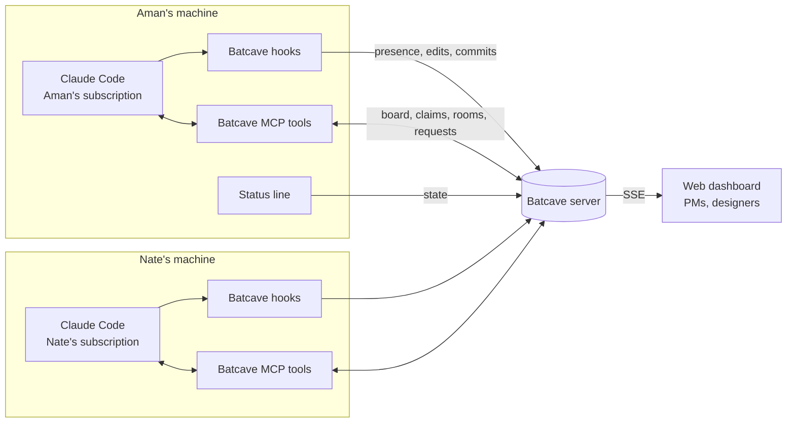

# Batcave

**Multiplayer Claude Code.** A shared board, live presence, rooms, pinned decisions, requests between teammates' Claudes, handoffs and an edit guard, for teams where everyone runs their own Claude Code.

Every teammate keeps their own Claude Code, their own machine and their own Claude subscription. Batcave shares the *state* between them.

```
● acme · 4 online · 1 request · T-11 running        ← your Claude Code status line
```

---

## Contents

- [Why](#why)
- [How it works](#how-it-works)
- [Features](#features)
- [Quick start](#quick-start)
- [Using Batcave](#using-batcave)
- [Configuration](#configuration)
- [Architecture](#architecture)
- [API reference](#api-reference)
- [Security and privacy](#security-and-privacy)
- [Deploying the server](#deploying-the-server)
- [Roadmap](#roadmap)
- [FAQ](#faq)

---

## Why

Coding agents made each developer faster and the team slower to align. More agents mean more code, more PRs and more merge conflicts, while the team's shared context sits in private terminals. Teams need to answer simple questions again: who is working on what, what did we decide, whose agent is touching this file, and where did my teammate leave off.

Batcave answers those questions inside the tool everyone already uses.

## How it works

Batcave has two parts.

1. **The server** (`server/`). A small Node service that holds the team's shared state: people, tasks, rooms, messages, decisions, requests, handoffs and recent file edits. It has a JSON API, a live event stream and a web dashboard. One server per team.
2. **The Claude Code plugin** (`plugin/`). Installed by each teammate. It contains:
   - **Hooks** that report presence and activity (edits, commands, commits, PRs) and inject the team's context into Claude's prompt.
   - **An MCP server** that gives Claude tools to read and change the shared state (board, claim, people, rooms, decisions, requests, handoffs, pulse).
   - **Slash commands** for people: `/batcave:board`, `/batcave:claim`, `/batcave:people` and more.
   - **A status line** showing the team at a glance.
   - **A setup skill** that walks anyone through installation.

### The one rule: everyone runs their own Claude

Batcave never holds anyone's Claude credentials, never proxies model calls, and never runs one person's Claude on another person's behalf. When Nate wants Aman's Claude to do something, he sends a **request**. It lands in Aman's inbox, and it runs only if Aman chooses to run it, in his own session, as his own prompt. This keeps every person's usage on their own account, and keeps a human in control of their own agent.

## Features

| Feature | What it does | Where |
|---|---|---|
| **Board** | Kanban with Backlog, Claimed, Agent running, In review, Done. Cards move on their own as hooks see agents start work, open PRs and merge. | `/batcave:board`, dashboard |
| **Claims** | `/batcave:claim T-14` assigns the task, names a branch, opens a room for it and loads its context into Claude. One active claim per person is the default; stale claims can be taken over. | `/batcave:claim` |
| **People** | Who is online, whose agent is running, what each agent is doing right now, claimed task, and weekly stats: shipped, PRs open, reviews owed, asks pending. | `/batcave:people`, dashboard, status line |
| **Rooms** | One chat per task plus `#team`. Agents post commits and status changes; people talk. | `/batcave:room`, `/batcave:say`, dashboard |
| **Decisions** | Pin a decision once ("Reuse surface tokens. No new colors.") and every teammate's Claude sees it in its context. | `/batcave:decide`, dashboard |
| **Requests** | Ask a teammate's Claude to do something. They choose Run, Edit first, or Decline. `@aman-claude` in a room message also creates a request. | `/batcave:ask`, `/batcave:requests` |
| **Guard** | Before Claude edits a file, Batcave checks whether another teammate's agent edited it recently and asks for confirmation if so. | automatic (PreToolUse hook) |
| **Handoff** | Pass a task with its branch, a summary, open todos and the relevant decisions. The receiver runs `/batcave:pickup` and starts with full context. | `/batcave:handoff`, `/batcave:pickup` |
| **Pulse** | What shipped, what is waiting on you, what is running, stale claims and new decisions since you last looked. | `/batcave:pulse` |
| **Dashboard** | A web view of the board, people, rooms and decisions for teammates who do not live in a terminal (PMs, designers). | `http://<server>/` |

## Quick start

### 1. Run a server (one person per team)

Requires Node 18 or newer. No `npm install` needed; the server has no dependencies.

```bash
git clone https://github.com/solanki-aman/batcave.git
cd batcave
export BATCAVE_TEAM=acme
export BATCAVE_TEAM_TOKEN=$(node -e "console.log(require('crypto').randomBytes(24).toString('base64url'))")
echo "Share this token privately: $BATCAVE_TEAM_TOKEN"
node server/src/index.mjs
# [batcave] team "acme" listening on http://0.0.0.0:4777 (token required)
```

For a real team, deploy it with Docker on any host with a persistent volume. See [Deploying the server](#deploying-the-server).

### 2. Install the plugin (every teammate)

In Claude Code:

```
/plugin marketplace add solanki-aman/batcave
/plugin install batcave@batcave
```

Restart Claude Code, then run:

```
/batcave:setup
```

The setup skill asks for the server URL, team token, your handle and display name, writes `~/.batcave/config.json`, offers to install the status line, and runs a health check. You can also do it by hand:

```bash
node ~/.claude/plugins/<...>/batcave/scripts/setup.mjs \
  --url https://batcave.example.com --token <team token> \
  --user aman --name "Aman" --statusline
node ~/.claude/plugins/<...>/batcave/scripts/doctor.mjs
```

### 3. Try it

```
/batcave:task Empty cart state
/batcave:board
/batcave:claim T-1
/batcave:people
/batcave:decide Reuse surface tokens. No new colors.
```

## Using Batcave

### Slash commands

| Command | Use it to |
|---|---|
| `/batcave:board [mine]` | See the board. |
| `/batcave:task <title>` | Add a task to the backlog. |
| `/batcave:claim <id>` | Claim a task, create its branch and load its context. |
| `/batcave:people` | See teammates, their agents' live state and weekly stats. |
| `/batcave:room [room]` | Read your task's room (or any room). |
| `/batcave:say <msg> \| summary` | Post to the room, or have Claude draft a summary of its work for you to approve. |
| `/batcave:decide <decision>` | Pin a decision for every teammate's Claude. Without arguments, list decisions. |
| `/batcave:ask <handle> <ask>` | Send a request to a teammate's Claude. |
| `/batcave:requests` | Review asks for your Claude: run, edit first, or decline. |
| `/batcave:handoff <handle> [id]` | Hand off a task with a summary and todos. |
| `/batcave:pickup <id>` | Pick up a handoff and get briefed. |
| `/batcave:pulse [hours]` | Catch up on the team. |
| `/batcave:setup` | Set up or repair Batcave on this machine. |

You do not have to use the commands. Claude has the Batcave tools available all the time, so "what is Nate working on?" or "claim the empty cart task" work in plain language too.

### What happens automatically

| Moment | Hook | Effect |
|---|---|---|
| Session starts | `SessionStart` | You show as online. Claude receives your active task, team decisions, recent room messages, pending requests and handoffs. |
| You send a prompt | `UserPromptSubmit` | Your agent shows as running. If the team context changed since the last prompt, Claude receives the update. |
| Claude is about to edit a file | `PreToolUse` | The guard checks for recent edits by other teammates' agents and asks you to confirm if it finds one. |
| Claude edits a file or runs a command | `PostToolUse` | Your "now" line updates. The file is recorded for the guard. `git commit` posts to your room. `gh pr create` moves your card to In review. |
| Claude finishes a turn | `Stop` | Your agent shows as idle. |
| Session ends | `SessionEnd` | You show as offline. |

Every hook fails open with a short timeout. If the server is slow or down, Claude Code keeps working normally.

### The task lifecycle

```
backlog ──claim──▶ claimed ──first edit──▶ running ──gh pr create──▶ review ──merge──▶ done
   ▲                  │                                                         (set by /batcave or dashboard)
   └────release───────┘   handoff keeps the card, changes the owner
```

A claim with no agent activity for 24 hours (configurable) is marked stale. Anyone can then take it over, and the room records who took it from whom.

## Configuration

### Per person: `~/.batcave/config.json`

Written by `setup.mjs` with mode 600. Never commit it.

```json
{
  "url": "https://batcave.example.com",
  "token": "team token",
  "user": "aman",
  "name": "Aman"
}
```

Environment variables override the file: `BATCAVE_URL`, `BATCAVE_TOKEN`, `BATCAVE_USER`, `BATCAVE_NAME`, `BATCAVE_HOME` (config folder), `BATCAVE_DEBUG=1` (print hook errors).

### Per repo: `.batcave.json` (optional, committed)

Non-secret team defaults for a repo.

```json
{
  "url": "https://batcave.example.com",
  "guardMinutes": 60,
  "shareActivity": true
}
```

Set `shareActivity` to `false` for repos where edits and commands should not be posted. Presence, claims and context injection still work.

### Server environment

| Variable | Default | Meaning |
|---|---|---|
| `PORT` | `4777` | Port to listen on. |
| `HOST` | `0.0.0.0` | Interface to bind. |
| `BATCAVE_TEAM` | `batcave` | Team name shown everywhere. |
| `BATCAVE_TEAM_TOKEN` | none | Shared secret. **Set it.** Without it the server accepts anyone. |
| `BATCAVE_DATA` | `./data/batcave.json` | Where state is persisted. |
| `BATCAVE_STALE_HOURS` | `24` | Hours without activity before a claim is stale. |
| `BATCAVE_GUARD_MINUTES` | `60` | Default guard window. |

## Architecture



Repository layout:

```
batcave/
├── .claude-plugin/marketplace.json   # lets /plugin marketplace add find the plugin
├── .claude/skills/batcave-setup      # symlink so the setup skill works inside this repo too
├── plugin/                           # the Claude Code plugin
│   ├── .claude-plugin/plugin.json
│   ├── .mcp.json                     # registers the MCP server
│   ├── hooks/hooks.json              # hook wiring
│   ├── hooks/batcave-hook.mjs        # one script, one mode per hook event
│   ├── mcp/server.mjs                # zero-dependency MCP server (stdio)
│   ├── commands/*.md                 # slash commands
│   ├── skills/batcave-setup/SKILL.md # guided setup
│   ├── scripts/setup.mjs             # write config, verify, install status line
│   ├── scripts/doctor.mjs            # health check
│   ├── scripts/statusline.mjs        # status line (10 s cache)
│   └── lib/client.mjs                # config + HTTP client shared by all of the above
└── server/
    ├── src/index.mjs                 # HTTP API, SSE, domain logic
    ├── src/store.mjs                 # JSON persistence
    ├── public/index.html             # dashboard
    └── Dockerfile
```

Design choices:

- **Zero dependencies everywhere.** Node 18 built-ins only, so the plugin works right after install with no `npm install`, and the server is one `node` command.
- **State lives on the server, work lives on laptops.** The server never sees code, only file paths, branch names, commit subjects and the messages people choose to post.
- **Context is pushed, not pulled.** Decisions and room messages reach Claude through hooks, so teammates do not have to remember to ask. Injection is deduplicated per session to save tokens.
- **Fail open.** Every hook has a 2.5 s network timeout and exits 0 on any error.

## API reference

All `/api/*` routes except `/api/health` need `Authorization: Bearer <team token>` and `X-Batcave-User: <handle>` (optionally `X-Batcave-Name`). Responses are JSON.

| Method | Route | Body / query | Purpose |
|---|---|---|---|
| GET | `/api/health` | | Liveness, team name, whether auth is on. |
| GET | `/api/state` | | Everything the dashboard needs. |
| GET | `/api/stream` | `?token=` | Server-sent events: `task`, `person`, `message`, `decision`, `request`, `handoff`. |
| POST | `/api/presence` | `status`, `agent`, `now`, `role`, `branch` | Update your presence. |
| GET | `/api/people` | | Teammates with presence and stats. |
| GET | `/api/tasks` | `?status=&owner=` | List tasks. |
| POST | `/api/tasks` | `title`, `description`, `source` | Create a backlog task. |
| GET | `/api/tasks/:id` | | One task. |
| POST | `/api/tasks/:id/claim` | `branch`, `force` | Claim (409 if someone else holds a fresh claim). |
| POST | `/api/tasks/:id/release` | | Back to backlog. |
| POST | `/api/tasks/:id/status` | `status`, `pr`, `reviewer` | Move a card. |
| GET | `/api/rooms` | | Rooms. |
| GET | `/api/rooms/:id/messages` | `?limit=` | Recent messages. |
| POST | `/api/rooms/:id/messages` | `text`, `kind` | Post. `@handle-claude` creates a request. |
| GET | `/api/decisions` | `?room=` | Active decisions. |
| POST | `/api/decisions` | `text`, `room` | Pin a decision. |
| POST | `/api/decisions/:id/retire` | | Retire a decision. |
| GET | `/api/requests` | `?box=inbox\|sent&status=` | Your requests. |
| POST | `/api/requests` | `to`, `text`, `room` | Ask a teammate's Claude. |
| POST | `/api/requests/:id/resolve` | `action: accept\|decline` | Recipient only. |
| POST | `/api/handoffs` | `task`, `to`, `summary`, `todos` | Owner only. Transfers the card. |
| GET | `/api/handoffs` | | Open handoffs to or from you. |
| POST | `/api/handoffs/:id/pickup` | | Recipient only. Returns the packet. |
| POST | `/api/events` | `type` (`turn_start`, `turn_end`, `edit`, `command`, `commit`, `pr`), `files`, `command`, `summary`, `url` | Activity from hooks. |
| GET | `/api/guard` | `?files=a,b&minutes=` | Recent edits by others to these files. |
| GET | `/api/context` | | The context bundle injected into Claude, including a ready-to-use `text`. |
| GET | `/api/pulse` | `?since=<ms>` | Done, review, running, stale, new decisions. |

## Security and privacy

- **Shared team token.** v0.1 trusts the `X-Batcave-User` header from anyone holding the token. That is fine for a trusted team on a private network or behind HTTPS. Per-user tokens or SSO are on the roadmap; do not expose an untrusted, public server.
- **What leaves a laptop.** Handle and display name, presence, task claims, repo-relative file paths Claude edits, the first line of commands Claude runs, commit subjects, PR URLs, and anything people or Claude post with `/batcave:say`. Never file contents or diffs. Prompts are not sent; the "now" line says "thinking", "editing Header.tsx" or "running npm test".
- **Opt out per repo** with `"shareActivity": false` in `.batcave.json`.
- **Requests never run themselves.** The context Batcave injects tells Claude not to act on requests unless the user chooses one in `/batcave:requests`.
- **Secrets.** The token lives only in `~/.batcave/config.json` (mode 600) or environment variables. Never commit it; `.batcave.json` is for non-secret settings only.

## Deploying the server

The server is a single process with a JSON file for state. Back up the data volume.

**Docker**

```bash
docker build -t batcave server
docker run -d --name batcave -p 4777:4777 \
  -v batcave-data:/data \
  -e BATCAVE_TEAM=acme -e BATCAVE_TEAM_TOKEN=<token> \
  batcave
```

**Fly.io, Render, Railway or a VM.** Use the Dockerfile in `server/`, mount a volume at `/data`, set `BATCAVE_TEAM` and `BATCAVE_TEAM_TOKEN`, and put it behind HTTPS. The SSE endpoint needs a proxy that does not buffer responses (on nginx: `proxy_buffering off;`).

**Scale.** The JSON store is fine for teams of tens. Past that, swap `server/src/store.mjs` for Postgres; nothing else depends on how state is stored.

## Roadmap

Built in v0.1: board with claims, people with stats, rooms, decisions, requests, handoffs, guard, pulse, status line, dashboard, setup skill.

Next:

- **Room pane and People pane mods** for the Claude Desktop Code tab, so the room and the team sit beside your session instead of in a separate tab.
- **Follow mode.** Watch a teammate's agent live, read only.
- **Shared plans.** `/batcave:plan` drafts a plan doc that teammates edit together; each step becomes a card.
- **Shared preview.** Tunnel a teammate's dev server into the room so PMs and designers see the running app.
- **Inline review** on diff cards, fed back into the owning agent's context.
- **Decision watcher.** Flag plans and diffs that contradict a pinned decision.
- **Per-user tokens and SSO**, multiple teams per server, Postgres store.
- **GitHub sync.** Import issues as cards, mark cards done on merge automatically.

## FAQ

**Is there one shared agent the whole team prompts?**
No, on purpose. Each person's Claude runs on their own account. Requests, handoffs and shared context give most of the benefit of a shared agent while keeping each person in control of their own.

**Does it need a cloud sandbox?**
No. Work happens in each person's local repo and branch, like today.

**What if the server goes down?**
Claude Code keeps working. Hooks time out quietly, the status line shows `○ batcave offline`, and state syncs again when the server is back.

**Can non-engineers use it?**
Yes. The dashboard at the server URL shows the board, people, rooms and decisions, and lets anyone add tasks, post, pin decisions and send requests to an engineer's Claude.

## License

MIT
