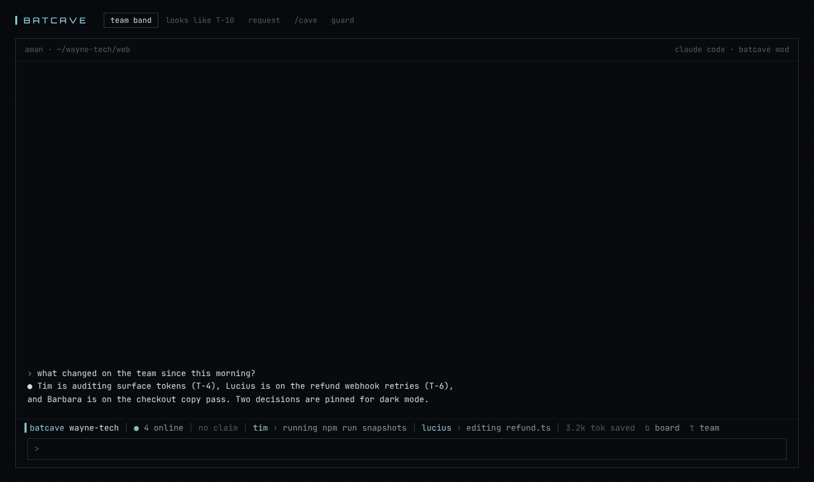
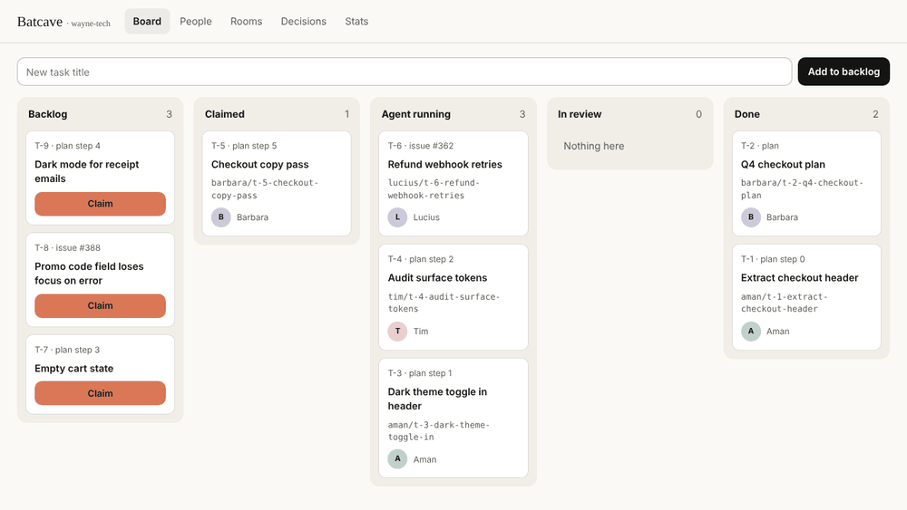
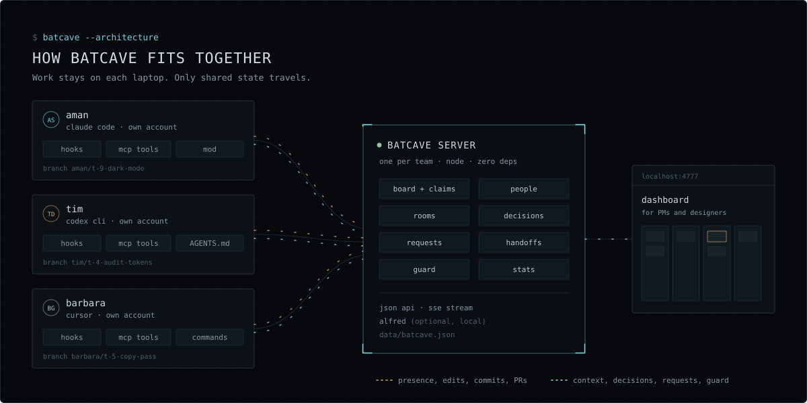

<p align="center">
  
</p>

<p align="center">
  <a href="LICENSE"></a>
  
  
  
  
</p>

<p align="center">
  <a href="https://solanki-aman.github.io/batcave/"><b>Website</b></a> ·
  <a href="#quick-start"><b>Quick start</b></a> ·
  <a href="docs/walkthrough.md"><b>Walkthrough</b></a> ·
  <a href="docs/reference.md"><b>Reference</b></a>
</p>

---

**Batcave is a shared workspace for teams whose developers each run a coding agent.** It gives every agent on the team one board with claims, live presence, pinned decisions, requests between teammates, handoffs, and a guard that stops two agents from overwriting the same file. It works across vendors: one teammate on Claude Code, another on Codex, a third on Cursor, all on the same board.

Everyone keeps their own agent, their own machine and their own account. Batcave shares state, never credentials, and never runs one person's agent for another.

<p align="center"></p>

## Works with

| Agent | Install | Team context | Activity | Guard |
|---|---|---|:---:|---|
| Claude Code | plugin | session start, every prompt | ✓ | asks |
| Codex CLI | `batcave init` | session start, every prompt | ✓ | asks |
| Gemini CLI, Antigravity | `batcave init` | session start, every prompt | ✓ | blocks once |
| Cursor | `batcave init` | session start, after tool calls | ✓ | blocks once |
| GitHub Copilot CLI | `batcave init` | session start, after tool calls | ✓ | asks |
| OpenCode | `batcave init` | `AGENTS.md` and tools | ✓ | blocks once |
| Kiro, Windsurf | `batcave init` | steering file or `AGENTS.md` | tools only | not yet |
| Any MCP client | manual | `AGENTS.md` | tools only | no |

*Blocks once* is for agents whose hooks cannot pause for a question: Batcave stops the first edit, the agent explains why, and the retry goes through if you approve.

## Quick start

**1. Start a server.** One person, once per team. Node 18 or newer; nothing to install.

```bash
git clone https://github.com/solanki-aman/batcave && cd batcave
export BATCAVE_TEAM=acme
export BATCAVE_TEAM_TOKEN=$(node -e "console.log(require('crypto').randomBytes(24).toString('base64url'))")
node server/src/index.mjs
```

For a real team, deploy `server/Dockerfile` behind HTTPS. See [Deploying](docs/reference.md#deploying-the-server).

**2. Connect your agent.** Every teammate.

Claude Code:

```text
/plugin marketplace add solanki-aman/batcave
/plugin install batcave@batcave
/batcave:setup
```

Every other agent, detected automatically:

```bash
npx github:solanki-aman/batcave init \
  --url https://batcave.example.com --token <team token> \
  --user aman --name "Aman" --repo
```

`init` writes each agent's own config with a backup, and `--repo` adds a short Batcave section to the repo's `AGENTS.md`. Undo with `batcave uninstall`.

**3. Use it.** Ask your agent for the board, or from any shell:

```bash
batcave board
batcave claim T-14
batcave decide "Reuse surface tokens. No new colors."
```

## Features

| | |
|---|---|
| **Board and claims** | Backlog, Claimed, Agent running, In review, Done. Cards move on their own as agents start work, open PRs and merge. Stale claims can be taken over. |
| **People** | Who is online, which agent they use, what it is doing now, and the week's shipped work, open PRs and reviews owed. |
| **Decisions** | Pin a decision once; every teammate's agent receives it as context. |
| **Requests** | Ask a teammate's agent to do something. It runs only if they choose to, in their own session. |
| **Guard** | Warns before an agent edits a file another teammate's agent changed recently, across vendors. |
| **Handoff** | Branch, summary, todos and decisions in one packet. The receiver starts with full context. |
| **Rooms and pulse** | A chat per task, agents post commits to it, and a briefing of what changed since you last looked. |
| **Dashboard** | The board, people, rooms and decisions in a browser for teammates who never open a terminal. |
| **Stats** | Hook and API latency (p50, p95), tokens injected into agents, and tokens saved, in the dashboard, `batcave stats` and the status line. |
| **Alfred** | Optional. Julia-1, a small open decision model, runs on CPU next to the server to rank which notes each agent needs and to spot decisions in chat. |

<p align="center"></p>

## How it works

<p align="center"></p>

- **Server.** One per team. Holds people, tasks, rooms, decisions, requests, handoffs and recent file edits. JSON API, live event stream and dashboard. Zero dependencies.
- **Hooks.** One script serves every agent; small adapters translate each vendor's payloads. They report presence and activity and push team context into the agent. Every hook fails open with a short timeout.
- **MCP server.** Eighteen tools (`batcave_board`, `batcave_claim`, `batcave_request`, ...) so any agent can read and change shared state.
- **CLI.** `batcave init` wires agents up; `batcave board`, `people`, `claim`, `say` and more work from any shell.

See the [walkthrough](docs/walkthrough.md) for five sequence diagrams of a team's day, and the [reference](docs/reference.md) for hooks, configuration and the API.

## Token savings and Alfred

Every token Batcave sends to an agent is counted, and so is every token it avoids sending:

- **Dedupe.** The server remembers what each session last received and only resends context when it changed.
- **Ranking.** With Alfred running, decisions and room messages are scored for relevance to the current prompt and task, and only the relevant ones are sent.

Alfred is [Julia-1](https://huggingface.co/SupersonicLabs/Julia-1) by Supersonic Labs (Apache-2.0, 144M parameters), a decision model that picks among supplied answers instead of generating text. It runs locally on CPU and is entirely optional: without it, Batcave uses plain rules.

```bash
batcave alfred install          # downloads Julia-1 (~580 MB) into ~/.batcave/alfred
batcave server --alfred         # starts the server and Alfred together
batcave stats                  # latency and savings
```

Alfred only advises. It never blocks an edit, grants access or accepts a request. Calls time out after 900 ms and fall back to rules. See [Alfred reference](docs/reference.md#alfred).

## Security and privacy

- **What leaves a laptop:** handle and name, presence, claims, repo-relative paths of edited files, the first line of commands, commit subjects, PR URLs and anything posted to a room. Never file contents, diffs or prompts.
- **Opt out per repo** with `"shareActivity": false` in `.batcave.json`.
- **Alfred is local.** It runs next to your server; no team data goes to a model provider.
- **Requests never run themselves.** Agents are told not to act on one unless the user picks it.
- **Auth:** v0.2 uses one team token and trusts the handle a client sends. Run it on a private network or behind HTTPS for a trusted team. Per-user tokens and SSO are on the roadmap.

## Roadmap

- Room and People panes inside the Claude Desktop Code tab
- Follow mode: watch a teammate's agent live, read only
- Shared plans whose steps become cards
- Shared preview of a teammate's running app
- Hooks for Kiro and Windsurf
- Per-user tokens, SSO, multiple teams per server, Postgres
- GitHub sync for issues and merges

## Contributing

Issues and pull requests are welcome. The codebase has no dependencies and no build step: `node server/src/index.mjs` runs the server, and `node cli/batcave.mjs help` runs the CLI from a clone. Adapters live in `plugin/lib/agents.mjs` and installers in `cli/installers.mjs`; adding an agent usually means one entry in each.

## License

[MIT](LICENSE)
