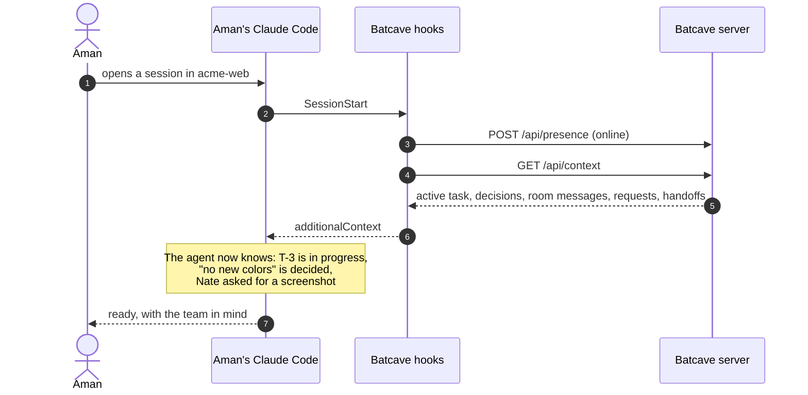
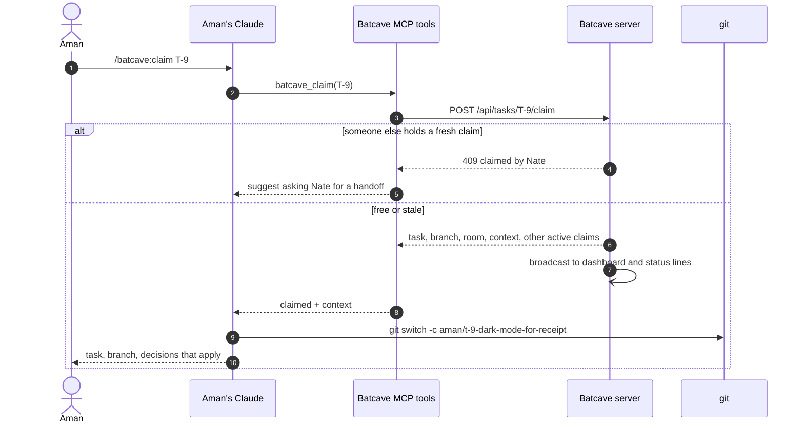
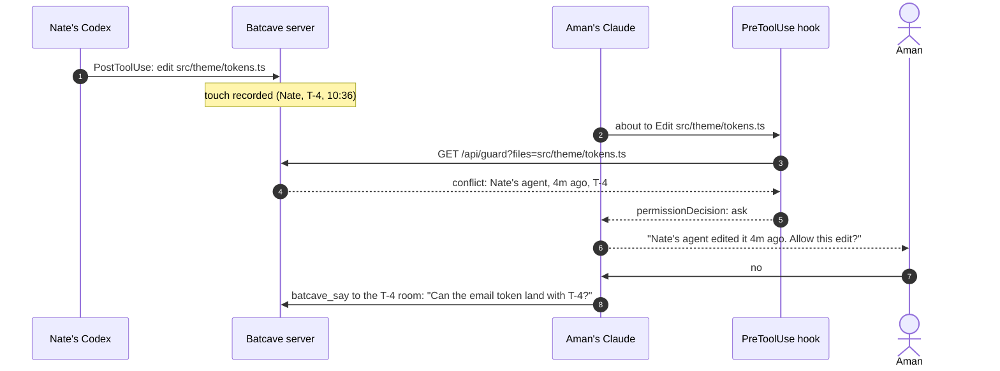
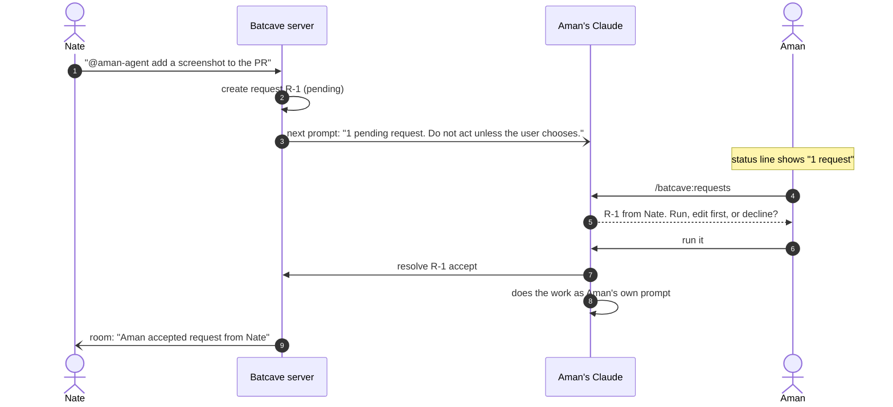
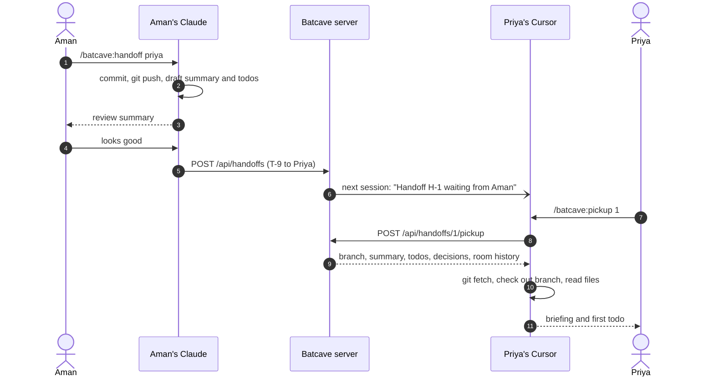

# A day in Batcave

Five moments, end to end. Each diagram is exactly what the plugin and server do.

## 9:02 &nbsp; Aman opens Claude Code and already knows the score

The session-start hook signs him in and hands his agent the team's context before he types anything. The same happens in Codex, Gemini CLI, Cursor and Copilot CLI.

## 9:15 &nbsp; Aman claims the next task

One command assigns the card, names a branch, opens a room and loads the task's context.

## 10:40 &nbsp; The guard stops a collision before it happens

Aman's Claude goes to edit `tokens.ts`. Nate's Codex edited it four minutes ago. Different vendors, same guard.

## 11:05 &nbsp; Nate asks Aman's agent for a favor

Requests are how one teammate gets help from another's agent without anyone borrowing a subscription.

## 5:30 &nbsp; Aman hands off and logs off

Handoffs move the card and carry everything the next person needs.

## The task lifecycle

A claim with no agent activity for 24 hours (configurable) is marked **stale**. Anyone can take it over, and the room records who took it from whom.
